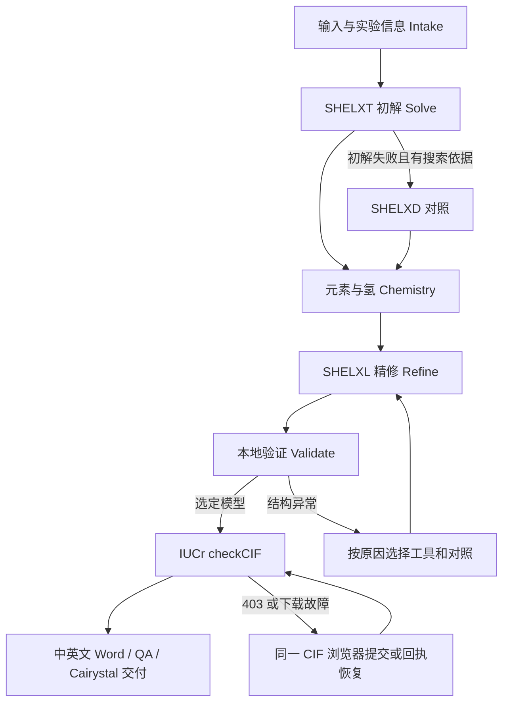

# 主线与工具衔接 / Workflow and tool handoffs

主线唯一数据源为 `assets/console/workflow-data.json`；命令行 `workflow --json` 与工作台读取同一份。工具接口唯一目录为 `assets/toolbox.json`，版本只读 `release_info.json`。本页说明共同衔接规则，避免在多处复制操作策略。



| 结果 / Result | 下一步 / Continuation |
|---|---|
| 化学、占有率、氢或无序仍有歧义 | 助手读取本次候选、密度和诊断，继续有依据的比较；保留明确的未解决处。 |
| 固定清单 OMIT 通过实现的接受检查 | 选定新 CIF/FCF，重新精修验证后回主线；保留 all-data 对照。 |
| ready_for_official_delivery 且上传已授权 | resume-delivery 使用原选定模型，不重解、不切换 CIF。 |
| 官网已有回执 | 核对 CIF 指纹后续取 PDF；提交结果未知时不自动重复上传。 |
| 官网和双语 Word 已生成且 QA 通过 | 自动 finalize/交付到原客户数据目录；缺失或 finding 不能伪装完成。 |

`describe TOOL --json` 保持各原生工具的输入/输出/退出码约定，并列出主线位置。此路线图不调度额外计算，也不把建议当作已实现的自动科学选择。实际自动化由 autorun、ab-auto 和交付续接脚本负责。

```text
python -B cairystal.py run resume-delivery -- --run FINISH_DIRECTORY --data-dir ORIGINAL_DATA_DIRECTORY --authorize-iucr-upload
```

授权仅在当前样品范围内传入。任务记录的 HKL/CIF 指纹和原始客户目录随交接保留；旧封存点缺原始目录时明确提供 --data-dir，不猜中间模型目录。

English: CLI and console share one route map. Native tool output/exit contracts stay unchanged. Scientific ambiguity goes to current-case evidence review; model edits return to refinement. Network/report failures resume the selected model. Generated files and automated QA do not certify chemical correctness or replace outstanding findings.
